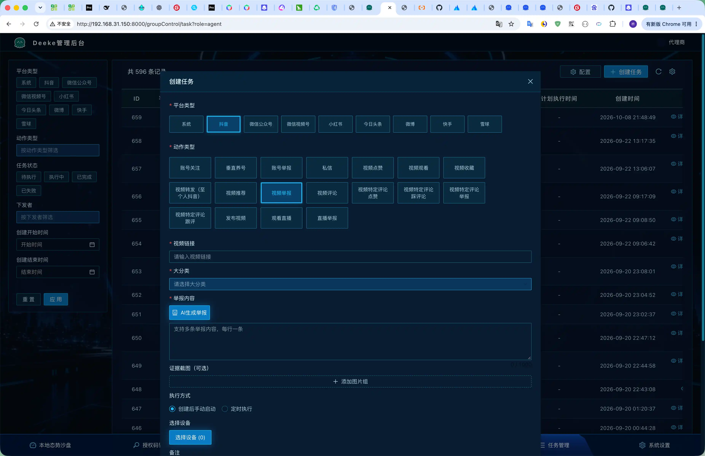
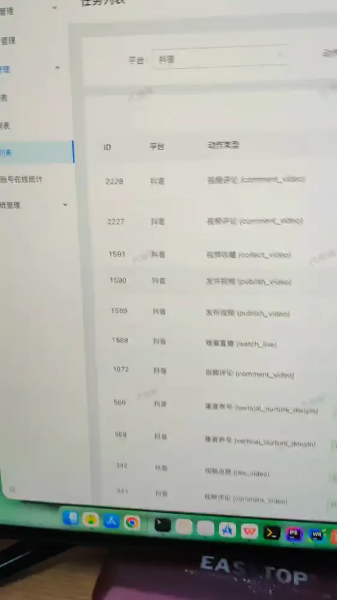
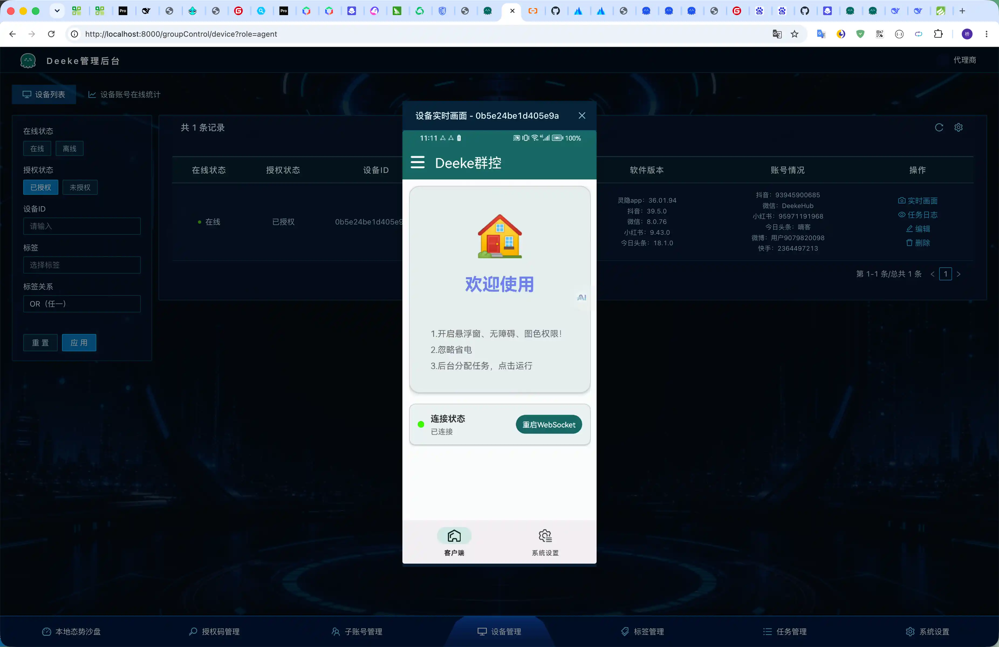
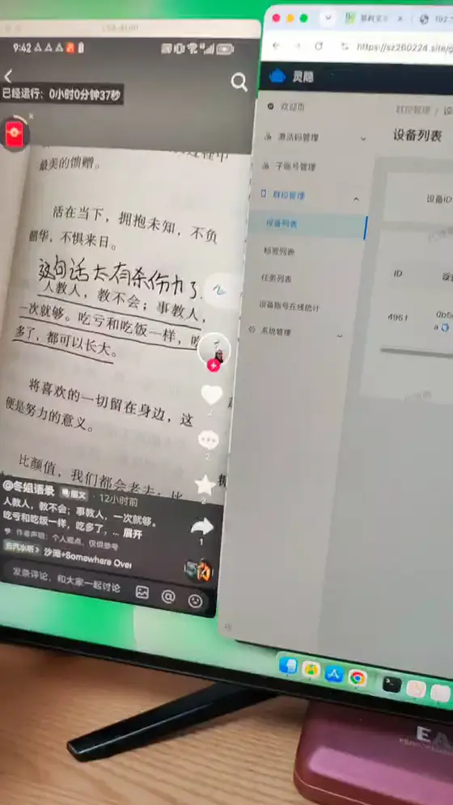
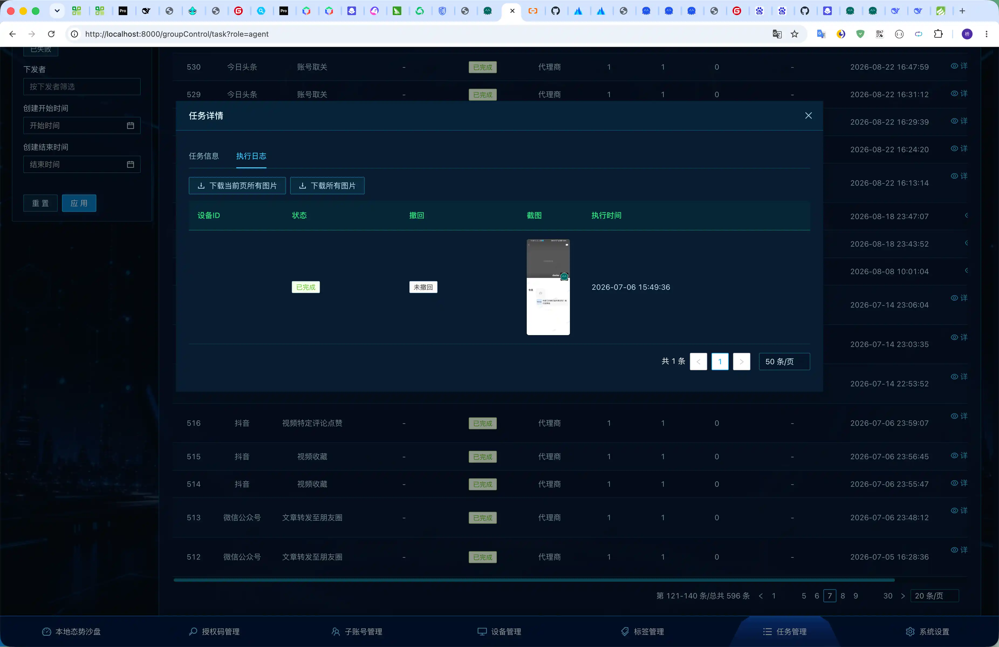

# 🚀 群控系统介绍

> 本系统仅用于研究学习，不得用于非法用途。

一套面向多台 Android 手机的远程群控系统。后台统一管理设备、下发任务、回看执行结果。手机端以 **Android Device Owner（设备所有者）** 模式运行，因此除了操作各平台 App，还能远程亮屏、息屏、重启、静默安装和升级客户端。

**适用场景：** 同一批设备要在多个内容平台上批量执行点赞、关注、互动、评论、发布、投诉，同时设备本身也要能远程维护。

### [👇 获取作者联系方式 👇](#bottom)

## 目录

- [页面展示](#页面展示)
- [核心优势](#核心优势)
- [系统组成](#系统组成)
- [支持的平台](#支持的平台)
- [系统平台能力](#系统平台能力)
- [安装包与客户端升级](#安装包与客户端升级)
- [统计](#统计)
- [任务管理](#任务管理)
- [实时画面](#实时画面)
- [设备与协作](#设备与协作)
- [使用步骤](#使用步骤)
- [联系方式](#bottom)

## 页面展示

### 任务创建

后台下发一条视频评论任务的操作过程：

[观看更清晰的原片](video/demo.mp4)

### 实时画面

自建 LiveKit 服务，查看画面不需要第三方付费。

手机端实时画面：

[观看更清晰的原片](video/living.mp4)

### 运行日志

## 核心优势

普通无障碍群控大多只能在屏幕亮着、应用已打开时点按界面。本系统的 Android 端运行在 **Device Owner** 模式：设备把群控客户端设为设备所有者后，后台可以直接下发系统指令，不必逐台解锁、点确认。

| | 能力 | 说明 |
|---|---|---|
| 🌙 | 息屏也能管 | 任务做完可以远程息屏省电，下次执行前再亮屏，设备不必一直亮着屏挂机 |
| 💡 | 亮屏即可开工 | 批量唤醒指定设备，再下发平台任务，不用人工逐台点亮 |
| 📦 | 安装包远程推送 | 后台上传各平台 APK 后按设备批量静默安装，可设置每台下发间隔，避免同一时刻全部下载把带宽打满 |
| ⬆️ | 客户端可远程升级 | 「升级 APP」面向群控客户端本身，版本更新不必收回手机 |
| 🔄 | 设备可远程复位 | 支持重启手机、重启群控客户端、重启 WebSocket 连接，掉线或卡死后可以从后台拉起 |
| 🧹 | 环境可清理 | 可关闭指定应用（如抖音）、清理下载图片，减少残留文件和前台占用 |
| 🧩 | 一台后台覆盖多平台 | 抖音、微信公众号、微信视频号、小红书、今日头条、微博、快手共用同一套设备、标签、任务和日志 |
| ✅ | 执行过程可核对 | 在线状态、各 App 版本、账号情况实时可见；任务可回传截图，失败设备可单独重试，支持撤回的动作可以一键撤回 |
| 📊 | 运行情况可总览 | 态势沙盘汇总设备在线、各平台账号、区域分布和近期任务；需要时还能对单台设备看实时画面 |

## 系统组成

| 部分 | 作用 |
|---|---|
| 管理后台 | 设备、标签、任务、安装包、统计沙盘、卡密与子账号 |
| Android 客户端 | 以 Device Owner 模式常驻设备，接收指令并操作本机与各平台 App |
| 实时通道 | WebSocket 维持在线与任务下发；画面查看使用 LiveKit |

设备通过激活码绑定席位。在线状态按心跳维护。离线设备不会假装执行成功：下发时离线会计入失败，之后可以只对失败设备重试。

## 支持的平台

任务按「平台 + 动作」组织。选择平台后，后台只展示该平台可用的动作和表单。

关注、点赞、推荐、转发、评论等动作，在支持的平台上可以撤回：系统会生成一条反向任务，只发给原先执行成功的设备。

| | 平台 | 覆盖范围 |
|---|---|---|
| 🎵 | 抖音 | 账号、视频、评论、发布、直播、垂直养号 |
| 💬 | 微信公众号 | 账号、文章、评论 |
| 📹 | 微信视频号 | 账号、视频、评论 |
| 📕 | 小红书 | 账号、贴文、评论、直播、垂直养号 |
| 📰 | 今日头条 | 账号、文章 |
| 📣 | 微博 | 账号、贴文、评论、直播 |
| ⚡ | 快手 | 账号、视频、直播 |
| ⚙️ | 系统 | 不进入内容 App，只下发设备指令 |

### 🎵 抖音

| 对象 | 动作 |
|---|---|
| 账号 | 关注、举报、私信 |
| 视频 | 点赞、观看、收藏、转发、推荐、评论、举报 |
| 评论 | 按关键词定位后点赞、踩、举报、跟评 |
| 发布 | 发布视频 |
| 直播 | 观看直播、直播举报 |
| 养号 | 垂直养号：按关键词刷视频，并按比例点赞、评论、关注 |

### 💬 微信公众号

| 对象 | 动作 |
|---|---|
| 账号 | 关注、投诉 |
| 文章 | 点赞、推荐、评论、投诉、转发到朋友圈 |
| 评论 | 点赞、踩、转发、投诉、跟评 |

> 账号投诉和文章投诉需要上传证据截图。

### 📹 微信视频号

| 对象 | 动作 |
|---|---|
| 账号 | 关注 |
| 视频 | 点赞、推荐、评论、投诉、转发到朋友圈 |
| 评论 | 点赞、踩、转发、投诉、跟评 |

> 公众号和视频号都在微信里完成。推送安装包时，两者合并为「微信」一个安装包。

### 📕 小红书

| 对象 | 动作 |
|---|---|
| 账号 | 关注、取消关注、私信、举报 |
| 贴文 | 点赞、收藏、评论、举报 |
| 评论 | 点赞、不喜欢、跟评、举报 |
| 直播 | 观看直播 |
| 养号 | 垂直养号：按关键词刷作品，并按比例点赞、评论、收藏 |

### 📰 今日头条

| 对象 | 动作 |
|---|---|
| 账号 | 关注、取关、私信、举报 |
| 文章 | 点赞、收藏、评论、举报 |

### 📣 微博

| 对象 | 动作 |
|---|---|
| 账号 | 关注、留言、投诉 |
| 贴文 | 点赞、评论、转发、投诉、发布 |
| 评论 | 点赞、不喜欢、回复、转发、投诉 |
| 直播 | 观看直播 |

> 部分投诉和转发支持附带图片。

### ⚡ 快手

| 对象 | 动作 |
|---|---|
| 账号 | 关注、私信、举报 |
| 视频 | 点赞、推荐、收藏、评论、举报 |
| 直播 | 观看直播、直播举报 |

> 举报类动作支持附带图片。

### ⚙️ 系统

平台选「系统」时，下发的是设备指令，不进入任何一个内容 App。这些能力依赖 Device Owner，是本系统和普通脚本群控的主要差别。具体指令见下一节。

## 系统平台能力

在任务里把平台选为 **系统**，即可对选中的设备批量执行：

| | 能力 | 说明 |
|---|---|---|
| 💡 | 亮屏 | 远程点亮屏幕，为后续平台任务做准备 |
| 🌙 | 息屏 | 远程关闭屏幕，任务间隙降低耗电和发热 |
| 🔄 | 重启手机 | 设备异常时远程重启 |
| 🔁 | 重启 APP | 重启群控客户端 |
| 🔌 | 重启 WebSocket | 连接异常时只重建长连接，不必动整机 |
| ⬆️ | 升级 APP | 远程升级群控客户端，可设置每台设备的下发间隔 |
| 📦 | 推送 APK 安装 | 从安装包库选择 APK，批量安装到设备，可设置下发间隔 |
| 🚫 | 关闭抖音 | 结束抖音进程，避免占着前台 |
| 🧹 | 清理下载图片 | 清理任务过程中下载到相册的图片 |
| 📋 | 设备账号在线统计 | 汇总设备上各平台账号的在线情况 |

亮屏、息屏可以和平台任务配合：先亮屏，再执行抖音或微信任务，结束后息屏。重启、升级、安装都不需要人守在手机旁边。

## 安装包与客户端升级

两件事分开，避免把「升级群控客户端」和「给手机装抖音 / 微信」混在一起。

### ⬆️ 升级 APP

升级对象是群控客户端（设备列表里的客户端版本）。

1. 在系统平台创建「升级 APP」任务。
2. 选中设备后下发。
3. 可填写每台设备的下发间隔，默认 3 秒，分批升级，降低同时下载的压力。

### 📦 推送 APK 安装

- 管理员把各平台安装包上传到安装包库，填写平台、版本号和备注。
- 代理商和子账号不能上传，但可以在「推送 APK 安装」任务里选用已上传的包。
- 当前可推送的应用：🎵 抖音、💬 微信、📕 小红书、📰 今日头条、📣 微博、⚡ 快手。
- 同样支持每台设备的下发间隔。
- 安装依赖 Device Owner，设备侧无需逐台弹出系统安装确认。

设备列表会展示客户端版本，以及抖音、微信、小红书、今日头条等 App 的版本。升级或安装之后，可以直接核对是否生效。

内容平台界面改版时，优先适配最新版。若最新版暂时无法适配，建议安装下面的版本：

| | 应用 | 建议版本 |
|---|---|---|
| 🎵 | 抖音 | 36.1.0 |
| 💬 | 微信 | 8.0.68 |
| 📕 | 小红书 | 9.43.0 |
| 📰 | 今日头条 | 18.1.0 |
| ⚡ | 快手 | 14.8.20.50289 |
| 📣 | 微博 | 16.9.1 |

## 统计

统计分两层：平时在设备列表里看单台状态；需要盘点时再主动采集一次全量账号。大屏把这些数据收成一张态势沙盘。

### 设备列表上的即时状态

每台设备直接显示：

- 在线或离线（由客户端心跳维持）
- 是否已授权
- 群控客户端版本，以及 🎵 抖音、💬 微信、📕 小红书、📰 今日头条等 App 版本
- 各平台账号情况：🎵 抖音、💬 微信、📕 小红书、📰 今日头条、📣 微博、⚡ 快手

选设备下发任务时，还可以按标签、在线状态、历史任务成功率筛选，避免把任务打到长期失败或已经离线的机器上。

### 设备账号在线统计

这是一次主动盘点，不是心跳顺带上报。在系统平台创建「设备账号在线统计」任务并下发后，手机会回报当前登录的平台账号，后台生成一条统计记录。

列表按任务汇总：

| 指标 | 含义 |
|---|---|
| 总设备数 | 这次统计覆盖的设备 |
| 🎵 抖音在线数 | 上报到抖音账号的设备数 |
| 💬 微信在线数 | 上报到微信账号的设备数 |
| 📕 小红书在线数 | 上报到小红书账号的设备数 |
| 📰 头条在线数 | 上报到今日头条账号的设备数 |
| 📣 微博在线数 | 上报到微博账号的设备数 |
| ⚡ 快手在线数 | 上报到快手账号的设备数 |
| 创建、更新时间 | 这次盘点的起止 |

点开详情可以看到每台设备的名称，以及它上报的小红书、抖音、微信、微博、快手账号。代理商只能看自己名下的记录。

设备列表里的「账号情况」会沿用最近一次上报，所以盘点做完之后，单台设备上也能看到结果。

### 本地态势沙盘

态势沙盘是一张总览大屏，按当前登录身份统计：

- 管理员看全部已激活设备
- 代理商看自己的设备
- 子账号只看分给自己的设备

测试子账号名下的设备不计入。

**顶部三个总数**

- **设备总数：** 已激活、已绑定的设备
- **任务下发数：** 已创建的任务
- **各平台账号总数：** 最近一次账号盘点里，各平台上报到账号的数量合计

**画面分区**

| 位置 | 内容 |
|---|---|
| 左侧 | **账号情况**：🎵 抖音、💬 微信、📕 小红书、📰 今日头条、📣 微博、⚡ 快手各自的在线账号数，以及占设备总数的比例。**设备在线情况**：在线、离线数量和在线率。**子账号设备情况**：各子账号分到的设备占比 |
| 中间 | 区域地图。设备打上 A–K 标签后，会对应到宿城、宿豫、泗阳、泗洪、沭阳、经开、洋河、湖滨、苏宿、其他。鼠标移入区域可以看到设备数、各平台账号数、设备在线率、近一个月任务数，以及该区域最近一条任务 |
| 右侧 | **近期任务**：最近的内容平台任务（不含系统指令），带备注、平台、动作、下发人和时间。**子账号使用情况**：各子账号近一个月创建的任务次数。**账号注册情况**：逐个子账号查看其设备上各平台已上报的账号数量 |

沙盘数据随设备心跳、任务和最近一次账号盘点更新。先跑一遍「设备账号在线统计」，各平台账号数和区域里的平台分布才有数。

## 任务管理

一条任务 = 一个平台 + 一个动作 + 一批设备 + 这份动作需要的参数。

### 创建

1. 填写任务名称和备注。备注会出现在任务列表和态势沙盘的近期任务里。
2. 选择平台。选「⚙️ 系统」时，动作是亮屏、息屏、安装、升级等设备指令；选内容平台时，动作是关注、评论、投诉等。
3. 选择动作。表单随动作变化，例如视频链接、账号、评论内容、举报分类、证据截图。
4. 选择设备。可按标签、在线状态、历史成功率筛选，也可以直接勾选。
5. 选择立即执行，或指定计划时间做成定时任务。

待执行的任务可以修改。定时任务在计划执行前 30 秒内锁定，避免改到一半已经被下发。执行中的任务不能删除。

已有任务可以复制，连同执行方式和计划时间一起带过去，方便同一动作换一批设备或改一版文案。

### 下发与节奏

点「启动」后任务进入执行中。

- 立即任务马上经 WebSocket 发给在线设备。
- 定时任务要先启动，到点才下发。只保存、不点启动，不会自动跑。
- 离线设备记为失败，并写入日志，不会算作成功。

节奏可以拉开，避免所有手机同一秒做同一个动作：

- 动作之间的随机等待（最短、最长秒数）
- 设备之间的下发间隔
- 升级 APP、推送 APK 还可以单独设置每台设备的下发间隔，默认 3 秒

评论、跟评、朋友圈文案支持多行，执行时随机抽一条。也可以先准备好一批评论，保存成评论批次，再按设备轮流分配，每台拿到的句子不同。

### 列表里能看到什么

| 列 | 说明 |
|---|---|
| 平台、动作 | 这条任务在做什么 |
| 备注 | 创建时填写的说明 |
| 状态 | 待执行、执行中、已完成、已失败 |
| 下发者 | 代理商或子账号 |
| 总设备数、成功数、失败数 | 这批设备的执行结果 |
| 计划执行时间 | 定时任务的下发时间 |
| 创建时间 | 任务入库时间 |

可按平台、状态、创建时间筛选。

### 执行之后

| | 操作 | 说明 |
|---|---|---|
| 🔍 | 详情 | 查看参数、目标设备、评论如何分到各设备。举报类任务带分类和证据图 |
| 📝 | 日志 | 每台设备一条记录，含状态、执行内容、错误信息和截图。可按动作、是否撤回、时间筛选。设备页也能按单台设备反查它做过的任务 |
| 🖼️ | 截图 | 需要留证的任务回传截图，支持当前页或全部打包下载 |
| 🔁 | 重试 | 只对仍失败的设备再次下发，已经成功的不重复执行 |
| ↩️ | 撤回 | 关注、点赞、推荐、转发、评论等可撤回动作，在原任务完成后生成一条反向任务，只发给原先成功的设备 |

> 投诉、举报需要的证据图在创建时上传。微信公众号的账号投诉、文章投诉必须带截图。

## 实时画面

设备列表里可以对在线设备发起实时画面，用来确认手机当前停在哪个界面、任务有没有点偏。

1. 在设备列表选择一台已绑定的在线设备，打开画面。
2. 后台通知该设备开始推流，并签发仅供观看的 LiveKit 令牌。设备负责推画面，后台只订阅，不能从网页反向操作那一路视频。
3. 页面先连接房间，收到视频后直接播放。约 15 秒仍没有画面，会提示设备未推流，需要确认设备在线且已收到指令。
4. 关闭窗口即断开观看。

> 画面依赖设备在线和 LiveKit 通道，适合抽查，不替代任务日志和截图。批量执行结果仍以任务的成功数、失败数和回传截图为准。

## 设备与协作

| | 能力 | 说明 |
|---|---|---|
| 🟢 | 在线与授权 | 列表区分在线 / 离线、已授权 / 未授权，可按状态、标签、备注、设备 ID 筛选 |
| 🏷️ | 标签分组 | 给设备打标签后，创建任务时按标签选设备。区域标签 A–K 同时用于态势沙盘地图 |
| 👥 | 子账号 | 代理商可以把一部分设备分给子账号。子账号只能看到分给自己的设备，并在这些设备上创建和执行任务。沙盘里的子账号设备占比、任务次数也按这个分配关系计算 |
| 🎫 | 席位管理 | 设备通过激活码绑定，支持按时长生成卡密、导出、调整剩余激活次数 |

## 使用步骤

1. 手机安装群控客户端，并设置为 Device Owner。
2. 使用激活码完成授权，设备出现在后台且状态为在线。
3. 按需打标签（含区域标签），或把设备分配给子账号。
4. 若平台 App 版本不符，先用「推送 APK 安装」装到建议版本；客户端有新版本时用「升级 APP」。
5. 需要掌握各平台账号时，下发一次「设备账号在线统计」，再到态势沙盘查看汇总。
6. 创建任务：选择平台、动作、目标设备和参数，立即执行或定时执行。
7. 在任务日志里查看成功、失败和截图。有疑问时对单台设备看实时画面。失败设备重试，需要撤销的动作执行撤回。
8. 一批任务结束后，可用「息屏」让设备待机。

## 联系方式

